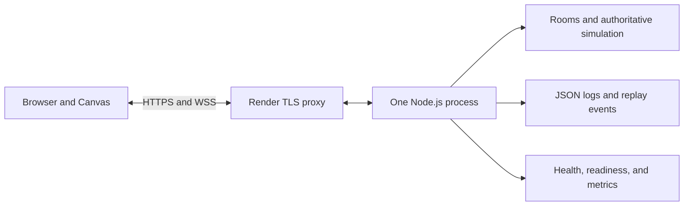
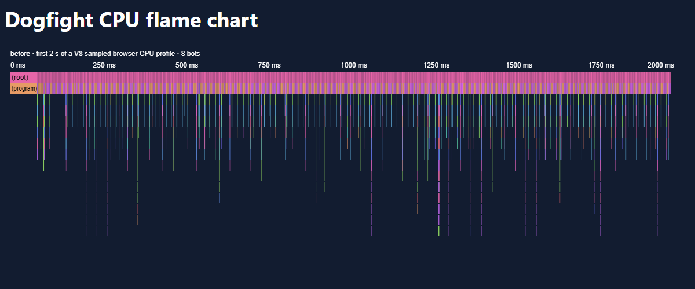
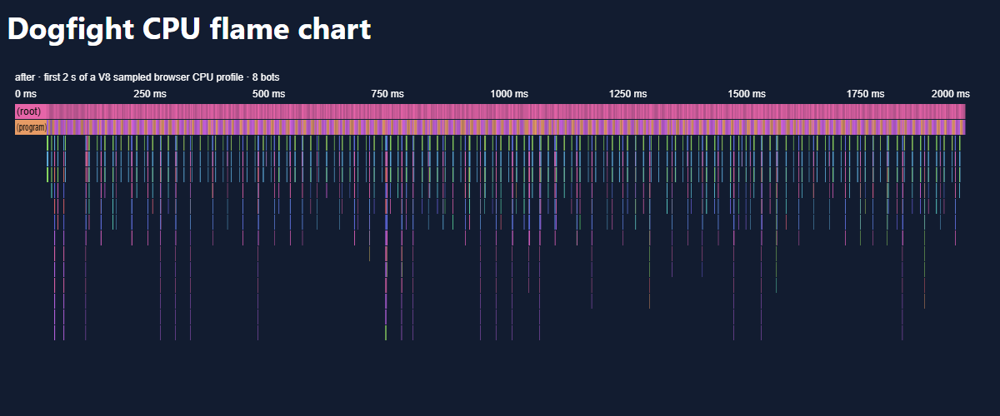
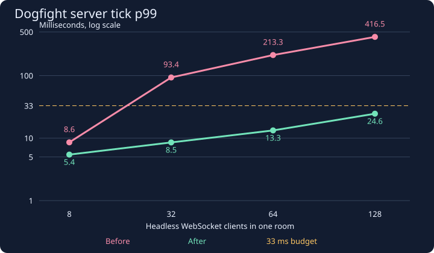

# Space Dogfight

Space Dogfight is a multiplayer space shooter for the browser. Pilot a ship, dodge asteroids, and fight in a shared arena. Destroy asteroids for points and earn five points for taking down another ship.

[](https://github.com/dariaKyrpata/lab-01-lmv/actions/workflows/typecheck.yml)

[Play Space Dogfight](https://space-dogfight-daria.onrender.com/) · [Server health](https://space-dogfight-daria.onrender.com/health) · [Live metrics](https://space-dogfight-daria.onrender.com/metrics)

## Play locally

Use the Node.js version in `.nvmrc` and run these commands from the repository root.

```sh
npm ci
npm run build
npm start
```

[Open the local lobby](http://127.0.0.1:3000/). Pick the same room as a friend and choose a different ship color. Use the arrow keys to steer and accelerate, Space to fire, F for a single shot, and H for homing. On a touch screen, drag the joystick on the right to steer and accelerate. Tap or hold Fire on the left to shoot. The browser can install the game from its menu when it is served over HTTPS. Online matches require a connection.

## Lab 8 — Production and deployment



The browser sends controls. The server advances the world at 30 ticks per second and sends snapshots to everyone in the room. The client predicts its own movement and interpolates other ships. See the [network measurements](#json-and-binary-measurements) and [server capacity measurements](#server-profile-and-load) below.

| Endpoint | Use |
| --- | --- |
| `/health` | Liveness and full Git SHA, also shown in abbreviated form in the game |
| `/ready` | Whether the server is accepting players |
| `/metrics` | Rooms, players, bots, traffic rates, tick p99, event loop utilization, memory, and rejected frames or upgrades |

The production server uses Pino for JSON logs. Join, leave, and connection errors include room and player identifiers when available. Shutdown rejects new connections, sends a notice and close code 1001, flushes replay events, and exits. Uncaught exceptions are logged and terminate the process with code 1.

### Production checks

```sh
docker compose up --build
```

To run the production smoke test against a fresh local Node process, build the client and run `node scripts/production-smoke.mjs`. It verifies origin and IP limits, oversized frames, rate limiting, join timeout, disconnect handling, malformed frames, and shutdown. The [local smoke report](docs/production/smoke-local.json) records the queueing time for 1,000 malformed frames and the healthy room's p99 before and after the flood. Windows exercises the shutdown handler through IPC. GitHub Actions runs the same checks with `docker stop`, enforces the 200 MB image limit, and runs the 8, 32, 64, and 128 client load test against a separate staging container. Browser tests cover two players, chat, restart recovery, and the mobile offline page and controls.

### Release on Render

The release workflow runs on `v*` tags. It builds and tests the image, then publishes the tagged image to GitHub Container Registry. Configure the hosting service once.

1. In GitHub Packages, grant Render read access to the image or make the package public. The tagged image is `ghcr.io/dariakyrpata/lab-01-lmv:v1.0.0`.
2. In Render, create a Web Service from **Existing Image** and point it at that image. Keep one instance. Set the health check path to `/ready`. The app recognizes `RENDER_EXTERNAL_URL` as an allowed origin. If you add a custom domain, include its HTTPS origin in `ALLOWED_ORIGINS`.
3. Set `TRUST_PROXY=1` for an instance reachable only through a proxy that appends the connecting IP to `X-Forwarded-For`. See [Render WebSockets](https://render.com/docs/websocket) and [deploying an image](https://render.com/docs/deploying-an-image).
4. Store the Render deploy hook in the GitHub Actions secret `RENDER_DEPLOY_HOOK_URL` and the HTTPS address in the repository variable `RENDER_PUBLIC_URL`. Rerun the release after adding them. The workflow checks the public SHA and opens a WSS session through the proxy. See [Render deploy hooks](https://render.com/docs/deploy-hooks).
5. Point an uptime monitor at the public `/health` endpoint. Record two players on separate networks and use their netgraph readings for the public RTT comparison.

### Known limits and next steps

Rooms live in one process, so a restart sends players back to the lobby and clears the match. The local load figures below come from the development machine. Hosting capacity depends on the instance's CPU and network. Replay files use local storage, which is ephemeral on a free Render instance. The demo room and bot APIs have no accounts. For a larger deployment I would add authenticated room controls, matchmaking, lag compensation, and either routing by room or a Redis backplane before adding instances.

### Live verification

Release `v1.0.0` is live on a single free Render instance in Frankfurt. The public `/health` endpoint reported commit `265c24cf02586a0d559f830bef88316b9d2aab37`. Two test clients on the same network joined Pink Galaxy over WSS and delivered a chat message. Their sampled netgraph RTTs were 56 ms and 53 ms. [Release workflow](https://github.com/dariaKyrpata/lab-01-lmv/actions/runs/42270813273)

The first deploy was configured in the Render dashboard. GitHub Actions needs the Render deploy hook and public URL configured in the repository to deploy future tags automatically.

The separate-network match, uptime monitoring, physical phone installation, and recorded demo are pending.

## Lab 7 — Engines, Memory, and Tests

```powershell
npm ci
npm run typecheck
npm run lint
npm run test:coverage
npm run build
npx playwright install chromium
npm run test:e2e
```

Vitest runs tests in all three workspaces. The suite covers vector math, fixed-step movement, collisions, deterministic world updates, reconciliation, the accumulator, rate limiting, and heartbeat expiry. Seven fast-check properties cover both codecs, frame lengths, malformed frames, in-arena movement, and message validation. Coverage thresholds apply to shared source lines and statements. Playwright uses two isolated Chromium contexts, one on JSON and one on Binary. It verifies the shared roster, observes movement in the second canvas within 500 ms, and delivers a chat message.

### Demo with eight bots

Run the server and client as in Lab 5, then join Pink Galaxy. In PowerShell, set the bot count for that room.

```powershell
$room = Invoke-RestMethod http://127.0.0.1:3000/api/rooms |
  Where-Object name -eq 'Pink Galaxy' |
  Select-Object -First 1
Invoke-RestMethod -Method Post -Uri "http://127.0.0.1:3000/api/rooms/$($room.id)/bots" `
  -ContentType 'application/json' -Body '{"count":8}'
```

The bot steers toward a nearby ship, evades at close range, and shoots when aligned. The server validates and queues its input with the same code used for a human. Send `{"count":0}` to remove the bots. Default rooms still have four human slots. The load script starts a separate local server with a larger room.

### Browser profile

Each run used Chromium Headless Shell 158.0.8127.18 on Windows with a Ryzen 5 7535HS. The scene had eight bots and one browser pilot holding thrust and fire, with a 1,000 × 700 viewport and a 30-second recording after warmup. The CPU flame charts show the first two seconds of the sampled stacks. The `?profile=1` option exposes timings for simulation, rendering, decoding, and reconciliation.

| Browser metric | Before | After |
|---|---:|---:|
| Frame interval p50 / p95 / p99, ms | 16.7 / 16.7 / 16.8 | 16.7 / 16.7 / 16.8 |
| Render work p50 / p95 / p99, ms | 1.2 / 1.6 / 1.9 | 1.1 / 1.5 / 1.8 |
| Simulate work p50 / p95 / p99, ms | 0.1 / 0.3 / 0.4 | 0.1 / 0.3 / 0.4 |
| GC events / major events | 40 / 21 | 37 / 21 |
| Total / longest GC pause, ms | 111.0 / 8.7 | 101.9 / 6.9 |

| Profile view | Before | After |
|---|---|---|
| Largest allocation samples | `readValue` 63.2 MB, anonymous 47.8 MB, `entries` 34.4 MB | `readValue` 60.0 MB, anonymous 46.7 MB, `runChecks` 15.1 MB |
| Largest named self-time samples | `measure` 2,074 ms, `fillText` 166 ms, `drawImage` 147 ms | `measure` 2,107 ms, `fillText` 117 ms, `dispatchEvent` 97 ms |




Decoding allocated the most memory. Caching the fixed schema's field lists took repeated `Object.entries` out of that path. The simulation now reuses bullets and explosion particles through bounded pools, writes positions and velocities into existing vectors, and keeps detached snapshots for network messages. Interpolation reuses its render samples across frames. A comparison against Lab 6 produced identical snapshots for 1,000 ticks with the same seed and four players.

The longest observed browser GC pause fell by 1.8 ms. The strict frame-interval target of under 16.7 ms and the zero-major-GC target were not met. Render work stayed below 2 ms at p99, but frame intervals followed the approximately 60 Hz headless display cadence. Snapshot decoding and validation still allocate, and these recordings include allocation sampling. Raw results are available in [before.json](docs/profile/before.json) and [after.json](docs/profile/after.json).

### Server profile and load

A 60-second Node 24.21 CPU profile of a seeded match with eight bots and scripted shooting measured tick p99 of **1.285 ms before** and **1.250 ms after**. The profiler showed bot steering, serialization, and validation, with collision checks outside the top self-time functions. Sharing encoded snapshots between clients with the same protocol and acknowledgment removed redundant serialization. The collision algorithm stayed unchanged. The isolated server run saw 0 major collections before and 1 after, so the browser's smaller pause did not carry over to every scenario.

The load script opens real WebSocket connections without browser windows. It sends movement and shooting inputs at 30 Hz, warms up each fresh server, and measures eight seconds per level. Throughput is aggregate snapshot/control payload received by all clients on loopback.

| Clients | Tick p99 before, ms | Tick p99 after, ms | Max tick after, ms | Event-loop use after | RSS after, MiB | Download after, MB/s |
|---:|---:|---:|---:|---:|---:|---:|
| 8 | 8.55 | 5.45 | 9.60 | 6.5% | 92.7 | 1.50 |
| 32 | 93.41 | 8.53 | 11.52 | 16.4% | 97.3 | 19.95 |
| 64 | 213.27 | 13.28 | 14.00 | 27.9% | 99.3 | 70.70 |
| 128 | 416.46 | 24.57 | 27.69 | 58.8% | 119.1 | 255.75 |



The initial run first exceeded the 33 ms budget at 32 clients. After caching, all tested levels through 128 clients stayed under 33 ms, including the maximum observed tick. This establishes capacity of **at least 128 clients on the tested loopback workload**. The saturation point beyond that range and capacity over an external network remain unmeasured.

### Web Worker experiment

The benchmark transferred 240 binary snapshots of 5,936 bytes each to a browser worker and received the decoded state back. Inline decoding took 70.8 ms total. Worker round trips took 149.0 ms, including transfer, scheduling, decoding, and return cloning. Posting the buffers took 2.7 ms on the main thread. The worker reduced synchronous decoding work on that thread, but increased the time to receive a usable state. It remains available only under `?worker-experiment`; the normal match keeps inline decoding.

For local measurements use `npm run build --workspace=client -- --minify=false` and `npm run profile:browser -- after`. The server CPU profile is available with `node scripts/profile-server.mjs after`, the headless load test with `npm run profile:load`, and the worker benchmark with `node scripts/worker.mjs`.

## Lab 6 — TypeScript

The shared simulation, codecs, WebSocket server, and browser game run from TypeScript source. Use Node.js 22.18 or newer for native type stripping on the server. Vite handles the browser build. Earlier standalone exercises and server integration test drivers remain in JavaScript.

```powershell
npm ci
npm run typecheck
npm run typecheck --workspaces
npm test
npm run build
```

TypeScript checks code before it runs. The server still validates untrusted inputs at runtime. Zod schemas check JSON messages and the server environment. Binary readers check packet length, version, flags, and numeric fields. The snapshot schema validates the decoded result.

### What TypeScript found

- Asteroid collisions wrote directly into vector coordinates. The collision code now replaces the vector, which lets the shared vector type protect its coordinates with `readonly`.
- A roster entry could arrive before its ship appeared in the current snapshot. Ship lookup now checks that the ID exists and belongs to a ship before reading its color or score.
- DOM queries can return `null` or the wrong element type. The lobby, chat, and netgraph now check required elements when constructing their UI.
- The connection queue could yield an undefined entry under indexed access. The send loop now checks the entry before sending it.

### Three types

- **`EntityId`, `Tick`, and `Seq`** are branded numbers. They are ordinary numbers on the wire, but TypeScript rejects passing a tick where an entity ID is expected.
- **`EntitySnapshot`** is a union of snapshots distinguished by `kind`. Checking for `"ship"` makes its health and color available. The exhaustive rendering and restoration switches reject a new kind at typecheck time until it has a handler.
- **`Bus<Events>`** links each event name to its payload. A listener for `fired` can read `shipId` without guessing which event it received.

A local comparison against Lab 5 produced identical simulation snapshots over 1,000 ticks with four players and the same seed and inputs.

The lobby and HUD keep the existing DOM and Canvas code. Their UI is small, so a framework would add a new build and rendering layer without simplifying this migration.

## Lab 5 — Real-Time Networking

Run `npm run dev:server` and `npm run dev:client` in separate terminals. Open two browser windows and join the same room with different player names.

- Binary mode: http://127.0.0.1:5173/?format=binary
- JSON mode: http://127.0.0.1:5173/?format=json

### Networking design

**Latency.** The server runs the simulation and sends snapshots at 30 Hz. When the client draws its own ship from snapshots alone, it must wait for the input to reach the server and for the resulting snapshot to arrive. Client-side prediction applies the same movement formula locally, so the ship responds immediately. The client also displays its own shots as soon as they are fired and replaces them with the server’s bullets when the corresponding input is acknowledged.

**Consistency.** Each input carries a sequence number (`seq`). Each snapshot includes `lastProcessedSeq`, which tells the client which inputs it can discard. The client starts from the ship state in the snapshot and replays the remaining inputs. The visual correction fades over roughly 100 ms. The shared simulation uses a fixed time step and a seeded random number generator so that the same starting state and inputs produce the same result.

**Cheating.** The server accepts control inputs and validates their format and sequence. It determines positions, hits, health, and scores. A player who changes their ship’s coordinates in the browser cannot use those coordinates to teleport on the server or on other players’ screens.

**Interpolation.** Remote ships and bullets are drawn between server snapshots. The default interpolation delay is 100 ms, about three server ticks. A shorter buffer displays more recent positions but is more likely to run out of snapshots when packets arrive unevenly. A longer buffer makes motion smoother at the cost of showing an older view of the match.

**Determinism experiment.** A controlled test ran 900 reconciliations with six unacknowledged inputs. The original movement formula produced zero positional correction. Adding `Math.random()` to the horizontal velocity in a temporary copy of the client formula increased the mean correction to 4.44 world units and the maximum to 16.18. The game files kept the deterministic formula.

The netgraph shows round-trip time, snapshot age, incoming and outgoing bytes per second, the number of unacknowledged inputs, and the latest correction magnitude. The network simulator can add delay, jitter, and message loss. The demonstration settings are 100 ms of delay per direction, 30 ms of jitter, and 2% loss.

### Binary protocol

Each binary message starts with a version byte (`1`) and a message type byte (`1` for input, `2` for snapshot). Multi-byte values are written with `DataView` in little-endian order.

- An input packet is 12 bytes. After the header, it contains `seq` and `tick` as `Uint32`, turn as `Int8`, and one byte of flags for thrust, fire, and homing.
- A snapshot contains `tick`, `sentAt`, `lastProcessedSeq`, and the world state. The [snapshot schema](shared/src/codec/binarySnapshot.js) defines the field order. Angles are stored as `Int16` with a step of approximately 0.0055°. Positions and velocities are stored as `Float64`.
- Room joins, chat, and other control messages use JSON in both modes.

### JSON and binary measurements

| Codec | Bytes per snapshot | Download per client, KB/s | Upload per client, KB/s | Encode + decode, µs |
|---|---:|---:|---:|---:|
| JSON | 10,575.7 | 317.27 | 3.01 | 173.3 |
| Binary (`DataView`) | 3,217.9 | 96.54 | 0.36 | 369.8 |

The benchmark ran in Node.js on 300 snapshots from a four-player simulation. Bandwidth figures are payload estimates at 30 snapshots and 30 inputs per second per client. In this benchmark, the binary format reduced snapshot size by about 70% and took longer to encode and decode.

Run the simulation and codec tests:

```powershell
npm test -- --project shared
```

## Lab 4 — Node.js, WebSocket and Streams

This laboratory extends the single-player browser game
with a Node.js server, real-time communication, rooms,
chat, streaming match logs, and replay functionality.

## Technologies

- JavaScript (ES Modules)
- Node.js
- Vite
- WebSocket (`ws`)
- EventEmitter
- Node.js Streams
- Transform streams
- NDJSON
- Node.js built-in test runner

## Project structure

```text
dogfight/
├── client/
│   ├── public/
│   ├── src/
│   │   ├── main.js
│   │   ├── connection.js
│   │   ├── online.js
│   │   ├── lobby.js
│   │   └── ...
│   └── vite.config.js
├── server/
│   ├── src/
│   │   ├── index.js
│   │   ├── config.js
│   │   ├── rooms.js
│   │   ├── protocol.js
│   │   ├── ws.js
│   │   ├── matchLogger.js
│   │   ├── replay.js
│   │   └── *.test.js
│   └── logs/
├── package.json
└── README.md
```

## Installation

Requirements:
- Node.js
- npm

Install dependencies from the project root:

```bash
npm install
```

## Development

Start the Node.js server:

```bash
npm run dev:server
```

In another terminal, start the Vite client:

```bash
npm run dev:client
```

Open:

http://127.0.0.1:5173/

Vite proxies `/api` and `/ws` requests to
the Node.js server.

## Production build

Build the client:

```bash
npm run build
```

Start the production server:

```bash
npm start
```

Open:

http://127.0.0.1:3000/

The Node.js server serves the built client
from `client/dist`.

## Environment configuration

Supported environment variables:

- `PORT` — HTTP server port (default: 3000)
- `HOST` — HTTP server host (default: 127.0.0.1)
- `LOG_DIR` — directory for NDJSON logs

Example (PowerShell):

```powershell
$env:PORT = "3000"
$env:HOST = "127.0.0.1"
$env:LOG_DIR = "./server/logs"

npm start
```

## HTTP API

### Health check

GET `/health`

Returns the server health status.

### List rooms

GET `/api/rooms`

Returns available rooms and player counts.

### Create room

POST `/api/rooms`

Request:

```json
{
  "name": "My Room"
}
```

### List replays

GET `/api/replays`

Returns available NDJSON match recordings.

### Stream a replay

GET `/api/replays/:fileName`

Streams recorded events as NDJSON.

## WebSocket

Endpoint:

`ws://127.0.0.1:3000/ws`

All client messages contain protocol version 1.

### Join room

```json
{
  "version": 1,
  "type": "join",
  "room": "room-id",
  "name": "Player"
}
```

### Send chat

```json
{
  "version": 1,
  "type": "chat",
  "text": "Hello!"
}
```

### Leave room

```json
{
  "version": 1,
  "type": "leave"
}
```

## WebSocket reliability

The server provides:

- Message validation
- Maximum message size
- Chat length restrictions
- Join timeout
- Rate limiting
- Ping/pong heartbeat
- Slow-client buffer protection
- Graceful shutdown

The browser client provides:

- Automatic reconnection
- Exponential backoff
- Outgoing message queue
- Event-based message handling

## Match logging

Room events are recorded in NDJSON format.

Recorded events include:

- `join`
- `chat`
- `leave`

Each record contains a timestamp and room ID.

The implementation uses a Transform stream
and a streaming pipeline.

## Replay

Replay files are read incrementally using
file streams and async iteration.

The server streams NDJSON events to HTTP clients
without loading the entire recording into memory.

## Testing

Run all server tests:

```bash
npm test -- --project server
node --test server/src/api.test.js server/src/ws.test.js
```

The HTTP API and WebSocket integration tests
require a running server.

The test suite currently contains 37 tests
covering protocol validation, rooms, API,
WebSocket communication, logging, and replay.

## Manual verification

1. Start the server and client.
2. Open the game in two browser windows.
3. Join the same room using different names.
4. Check that both names appear in the roster.
5. Send messages between the two clients.
6. Close both windows.
7. Check NDJSON files in the log directory.
8. Open `/api/replays`.
9. Stream one replay through its HTTP endpoint.

## Scope

Lab 4 implements room membership, chat,
network communication, and event logging.

Game-state synchronization and multiplayer
ship movement are outside the scope of Lab 4.

## Performance and reliability tests

### Streaming memory test

Run:

    node server/src/memoryTest.js

The test streamed 100,000 NDJSON events.

Measured results:
- Initial RSS: 60.61 MB
- RSS after 100,000 events: 70.66 MB
- Peak RSS: 71.98 MB
- Events processed: 100,000

The test demonstrates incremental processing without
loading the entire log file into memory.

### Slow WebSocket client test

Run:

    node server/src/slowClientTest.js

Measured results:
- Messages sent: 200
- Messages received: 200
- Sender disconnected during test: no
- Client bufferedAmount after resuming: 0

The receiver was temporarily paused during transmission.
All messages were received after reading resumed.

This test does not prove that the server's buffer limit
was reached. It verifies basic behavior under a
temporarily slow receiver.

